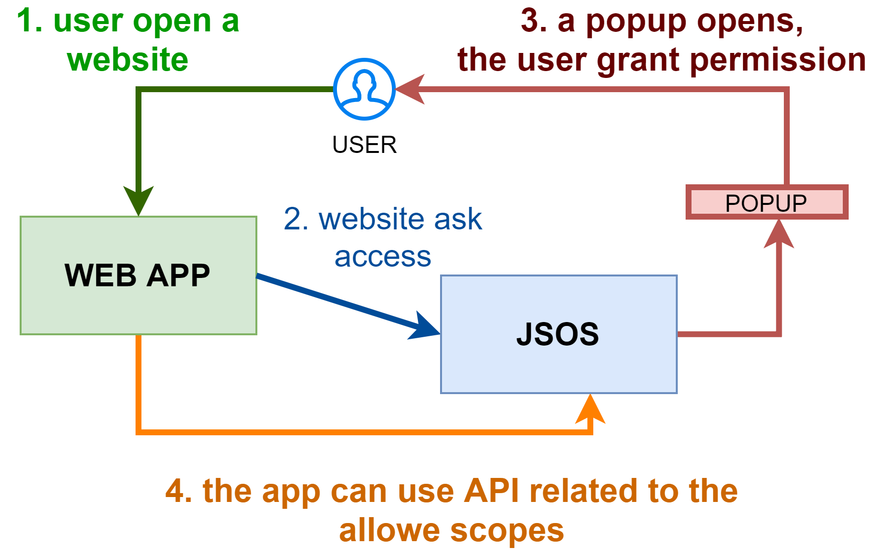

# jSOS
A tool for adding features like file system access to JavaScript

<image src="https://github.com/zeppaman/jSOS/blob/master/logo.png?raw=true" align="left" width="250"/>

# Why
In a world where we are delivering powerful JavaScript applications, we would have the possibility to print and interact with the file system to be able to develop full desktop applications with JavaScript.
Often the parts that need such capabilities are very limited, so it is quite expensive creating and maintaining a desktop application or an embedded application (Electron).

# How it works
The simple idea behind jSOS is to create a host application that exposes all the features available on the Desktop side (filesystem, OS, printing, etc..) through an API. In that way your JavaScript application will be able to do what you need,  just using regular API calls to localhost.
The feature access is scoped and profiled for the app, so that the user will be able to allow for each application only the needed features. In other words, it is like the permissions on your smartphone.
The JSOS app will be running in the background, so each application that will need this tool will be able to interact without any friction.



# Security considerations
Mentioned JavaScript limitations are here to prevent security issues and it is easy to understand that they are needed. That's why introducing such extensions is open to security considerations.
The overall principle is that if your user allows an application to access some resources, he trusts it and is able to evaluate the impact on his device. Something like when you go to the app marketplace and install an app. If you trust the crossword game to access your phonebook and your gallery...it is your decision.
Comparing to the scenario when you install a desktop application, you have more control about what the application does, because the web app will need to ask for the proper permission to jSOS. Everything will be transparent.
The access to the API is limited to the local host by default, so another PC in the LAN cannot try to use it. Each call to the API is authorized by a token that is generated during registration and avoids third parties being able to act on behalf of the app you trusted.

**Note** All the precautions listed above doesn't prevent the phishing scenario. If some malicious web site tries to register an app called "Google" and the user is not able to detect that this website is not Google, he may trust the wrong application. This is the big difference from smartphones' stores: in marketplace apps identity is granted by the vendor.


# Tutorial

## register an application

POST http://localhost:54320/app/register

```
{
    "AppName":"MyApp",
    "Needs":
    [
        "OS/READ",
        "OS/WRITE",
         "FILE/READ",
         "FILE/WRITE",
         "FILE/DELETE"
    ],
    "Async":false,
    "Token":"mysecret"
}
```

| Parameter  | Description |
| ------------- | ------------- |
| AppName  | The name of your app  |
| Token  | The secret used for ask for modification of permission (other websites cannot ask for permission removal or adding)  |
| Needs  | The list of permission asked (string list) |
| Async  | if true the request will register a new app without asking the user for approval with a prompt. The user will need to open the app and grant permission manually. If false the user will be asked for a prompt and request will wait the user response. In case of timeot the app is registered, so the user can manually change permission. |


## invoke a service
By convention each request must have these headers:

- Token: the secret used during app registration
- AppName: the name of the app used

Then the request must be compliant with the functional part of the service (ie. passing path to get files into a folder)

All paths in next part of the documentation omits the hostname part. So, if you read /filesystem/file/save you will have to use probably something like http://localhost:54320/filesystem/file/save


## File system API
This set of API extends the filesystem usage. There are 3 different authorization levels:

- file/read (read access to the file system)
- file/write (write access to the file system, without deletion)
- file/delete (delete access to the file system)

Such permissions are non inclusive, so if you want to create, update and delete a file you need all of them. The filesystem access is unrestricted and limited only by user limitation introduced by OS.
In future we should have different scope for a better app isolation ( like: access only user profile, access only an embedded folder for the app... ).

### POST /filesystem/file/save
Save a file starting from a base64 string

**QUERY PARAMS**
 -filepath

**FROM BODY**
- contentBase64

 **REQUIRED PERMISSION**
 - file/write

### GET /filesystem/file/read 
read file content as base64

**QUERY PARAMS**
 - filepath

**REQUIRED PERMISSION**
 - file/read

### DELETE /filesystem/file/delete
Delete a file

**QUERY PARAMS**
 - filepath

 **REQUIRED PERMISSION**
 - file/delete

### POST /filesystem/directory/create
Create a directory if not exists

**QUERY PARAMS**
 - path

**REQUIRED PERMISSION**
 - file/write

### DELETE /filesystem/directory/delete 
Delete a file

**QUERY PARAMS**
 - path

**REQUIRED PERMISSION**
 - file/delete

### GET /filesystem/directory/files
List all files in a folder, given a search pattern. The search can be recursive.

**QUERY PARAMS**
 - path: folder path
 - searchPattern: search pattern, something like *.*  or * to return all files 
 - recursive: if true search in subfolder

**REQUIRED PERMISSION**
 - file/read

## File system API
This set of API expose OS info like current username, environment variables and performance counters.

### GET /OS/whoami
Return the full username (DOMAIN\USER)

**REQUIRED PERMISSION**
 - os/read

### GET /OS/username
Return the username

**REQUIRED PERMISSION**
 - os/read

### GET /OS/domainname
Return the domain name

**REQUIRED PERMISSION**
 - os/read

### GET /os/variable 
Return a system variable given the name

**QUERY PARAMS**
 - variableName

**REQUIRED PERMISSION**
 - os/read


### GET /os/cpu
Return CPU usage

**REQUIRED PERMISSION**
 - os/read

### GET /os/ram
Return RAM usage

**REQUIRED PERMISSION**
 - os/read
